# 🎯 AI Job Application Assistant

[](https://python.org)
[](https://streamlit.io)
[](LICENSE)
[]()

> **Advanced AI-Powered Career Intelligence Platform**
> 
> Transform your job application process with intelligent resume analysis, personalized career guidance, and comprehensive interview preparation tools.

## 🌟 Project Overview

The **AI Job Application Assistant** is a sophisticated, modular web application that revolutionizes how job seekers prepare and optimize their applications. Using advanced Natural Language Processing, Machine Learning, and intelligent matching algorithms, it provides comprehensive career intelligence and actionable insights.

### ✨ **Core Capabilities**
- 🔍 **Smart Resume Analysis** - Multi-format parsing with ATS optimization
- 🎯 **Intelligent Job Matching** - Semantic similarity and skill alignment
- 📊 **Market Intelligence** - Industry benchmarking and competitive analysis  
- 🚀 **Career Acceleration** - Personalized learning paths and growth strategies
- 🤖 **AI Career Chat** - Interactive career guidance and advice
- 📄 **Professional Templates** - Industry-specific resume templates
- 🎤 **Mock Interviews** - Realistic interview simulation with feedback

### 🏗️ **Architecture Philosophy**
Built with a **modular, scalable architecture** that separates concerns and enables rapid feature development:
- **Separation of UI and Business Logic** for maintainability
- **Component-based Design** for reusability
- **Intelligent State Management** for seamless user experience
- **Extensible Plugin Architecture** for future enhancements

## 🛠️ Technology Stack

### **Core Technologies**
| Category | Technologies |
|----------|-------------|
| **Backend** | Python 3.8+, Streamlit Framework |
| **NLP/ML** | spaCy, NLTK, scikit-learn, FuzzyWuzzy |
| **Data Processing** | pandas, NumPy, JSON, CSV |
| **Document Processing** | pdfplumber, python-docx, PyPDF2 |
| **Visualization** | Plotly, Streamlit Charts, CSS3 |
| **Text Analysis** | TF-IDF, Cosine Similarity, Semantic Matching |
| **UI/UX** | Custom CSS, Interactive Components, Responsive Design |

## 📁 Modular Project Architecture

### **📂 Directory Structure**
```
ai-job-application-assistant/
├── 📄 app.py                           # Main application entry point
├── 📋 requirements.txt                 # Python dependencies
├── 📖 README.md                       # Comprehensive documentation
│
├── 🧠 core/                           # Business Logic Layer
│   ├── __init__.py                    # Package initialization
│   ├── 📄 resume_parser.py            # Multi-format resume processing
│   ├── 💼 jd_processor.py             # Job description analysis
│   ├── 🔍 matcher.py                  # Intelligent matching algorithms
│   ├── 🎯 recommender.py              # Personalized recommendations
│   ├── 📊 career_analyzer.py          # Career intelligence & analytics
│   └── 🛠️ utils.py                    # Shared utilities & helpers
│
├── 🎨 ui/                             # User Interface Layer
│   ├── __init__.py                    # UI package initialization
│   ├── 🧩 components.py               # Reusable UI components
│   ├── 📊 sidebar.py                  # Navigation & settings
│   ├── 💬 modals.py                   # Modal dialogs & popups
│   ├── 📝 input_section.py            # Input handling & validation
│   ├── 📋 results_display.py          # Results visualization
│   │
│   └── 📑 tabs/                       # Feature-specific tabs
│       ├── 📊 summary_tab.py          # Overview & key metrics
│       ├── 🎯 skills_analysis_tab.py  # Skills gap analysis
│       ├── 📋 resume_structure_tab.py # Resume quality assessment
│       ├── 💡 recommendations_tab.py  # Improvement suggestions
│       ├── 🎤 interview_prep_tab.py   # Interview preparation
│       ├── 📈 analytics_tab.py        # Advanced analytics
│       ├── 🤖 ai_chat_tab.py          # AI career assistant
│       ├── 📄 resume_templates_tab.py # Professional templates
│       ├── 🎪 mock_interview_tab.py   # Interview simulator
│       └── 📚 [13 more specialized tabs...]
│
├── 📊 data/                           # Knowledge Base & Data
│   ├── 🧬 skills_taxonomy.json        # Comprehensive skills database
│   ├── 💼 job_templates.json          # Role-specific templates
│   ├── 🎤 interview_questions.csv     # Question bank by domain
│   ├── 💰 salary_data.json            # Market salary intelligence
│   ├── 📈 market_trends.json          # Industry trends & insights
│   └── 🏢 company_insights.json       # Company-specific data
│
├── 📄 assets/                         # Sample Files & Resources
│   ├── 📄 sample_resume.txt           # Example resume
│   └── 💼 sample_jd.txt               # Example job description
│
└── 📚 docs/                           # Documentation
    ├── 🚀 quick_start_guide.md        # Getting started guide
    ├── 🏗️ enhanced_project_summary.md # Technical overview
    └── 📝 project_report_notes.txt     # Development notes
```

### **🏗️ System Architecture Diagram**

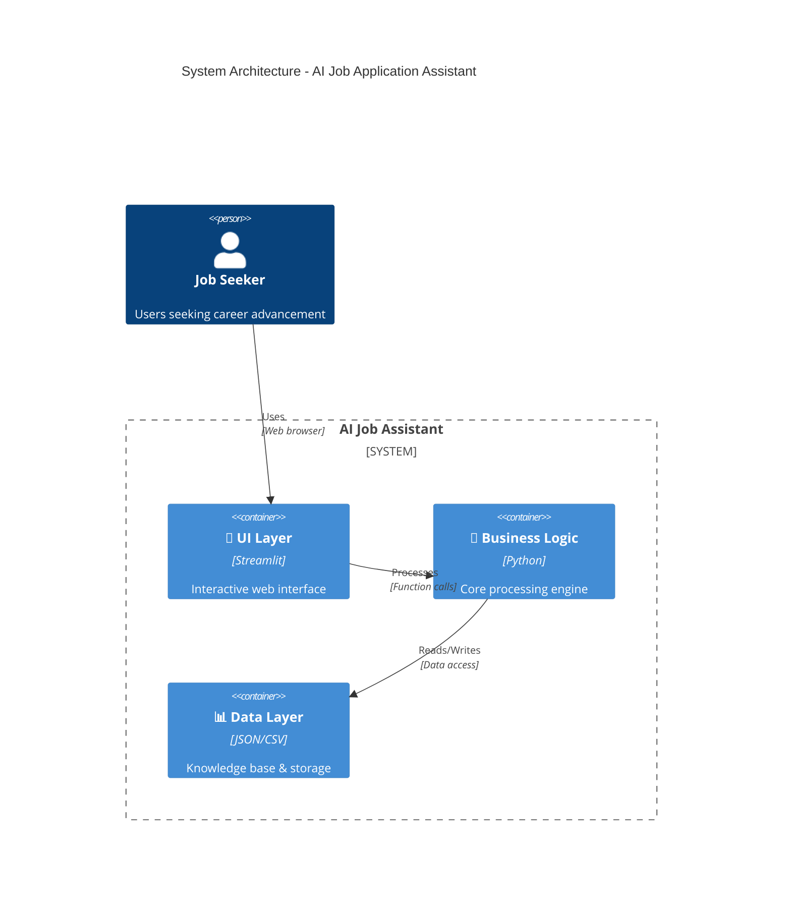

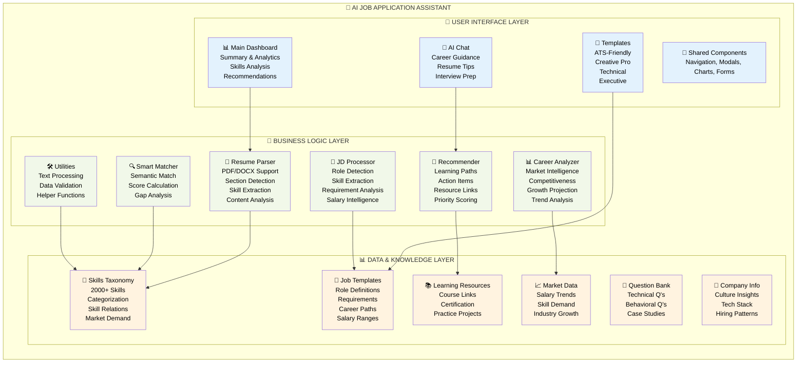

### **🔄 Data Flow Architecture**

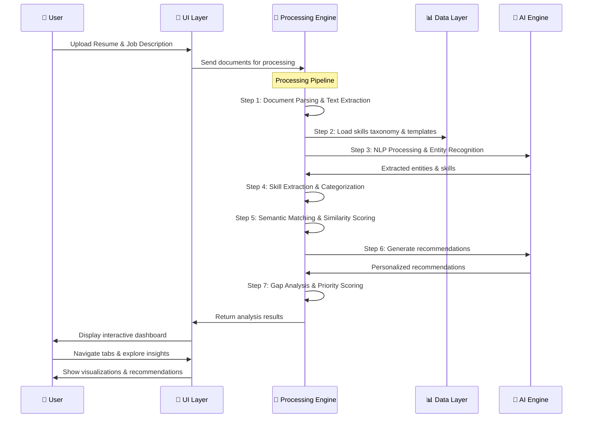

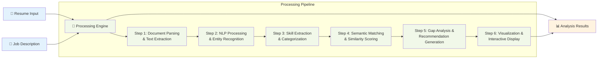

## 🚀 Comprehensive Feature Suite

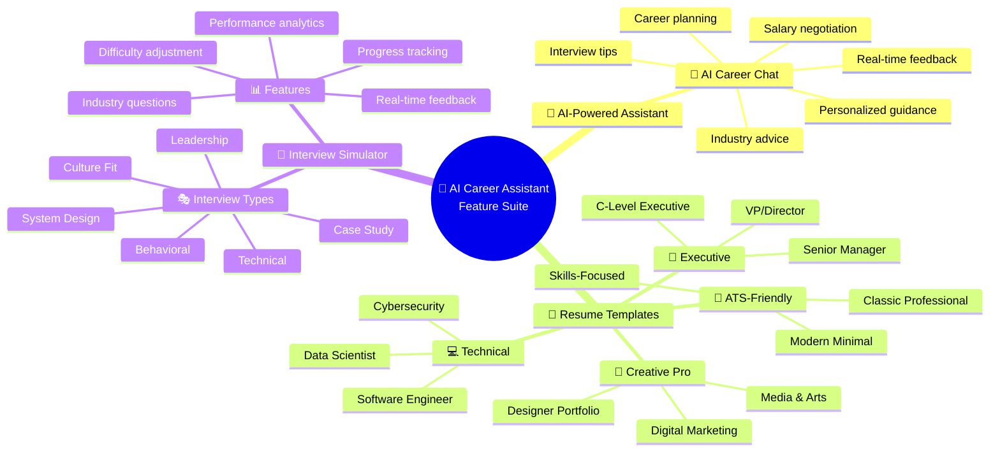

### **1. 🔍 Advanced Resume Analysis**
- **📄 Multi-Format Support** - PDF, DOCX, TXT with intelligent parsing
- **🤖 ATS Optimization** - Applicant Tracking System compatibility scoring  
- **🔍 Section Detection** - Auto-identification of resume components
- **✉️ Contact Validation** - Email, phone, LinkedIn verification
- **📊 Quality Metrics** - Content analysis and structure scoring
- **🏷️ Smart Categorization** - Technical vs soft skills organization

### **2. 💼 Intelligent Job Processing**
- **🎯 Role Classification** - AI-powered job type detection
- **⭐ Skill Prioritization** - Critical vs nice-to-have identification  
- **📈 Experience Analysis** - Seniority and progression requirements
- **💰 Salary Intelligence** - Market rate extraction and analysis
- **🏢 Company Insights** - Work culture and environment detection
- **📊 Complexity Assessment** - Job difficulty and requirements analysis

### **3. 📊 Market Intelligence Engine**
- **🌍 Market Positioning** - Competitive analysis and benchmarking
- **📈 Industry Trends** - Salary comparisons and demand forecasting
- **🎯 Experience Alignment** - Career stage and role suitability
- **🔥 Skill Demand Analysis** - Trending technologies identification
- **🚀 Growth Projections** - Career advancement pathway mapping

### **4. 🧠 Advanced Matching Algorithms**
- **🔄 Multi-Dimensional Analysis** - Skills, experience, and cultural fit
- **⚡ Priority Gap Detection** - Critical skill deficiency identification
- **📊 Competitiveness Scoring** - Market readiness probability
- **🔍 Semantic Matching** - Contextual skill relationship mapping
- **🎯 Personalized Recommendations** - Role and experience-appropriate advice

### **5. 🎯 Career Intelligence Platform**
- **📋 Strategic Guidance** - Application readiness and timing optimization
- **🛤️ Learning Pathways** - Customized skill development roadmaps
- **📚 Resource Integration** - Curated courses, certifications, projects
- **🎤 Interview Intelligence** - Role-specific preparation strategies
- **🌐 Networking Strategies** - Professional connection recommendations

### **6. 📈 Advanced Analytics Dashboard**
- **📊 Real-Time Visualization** - Interactive charts and progress tracking
- **📈 Market Intelligence** - Industry analysis and trend reporting
- **🎯 Success Metrics** - Application probability and improvement tracking
- **📚 Learning Analytics** - Skill development progress monitoring
- **🔮 Predictive Modeling** - Career trajectory and opportunity forecasting

## 🎨 Interactive Web Dashboard

### **📱 Multi-Page Application Structure**

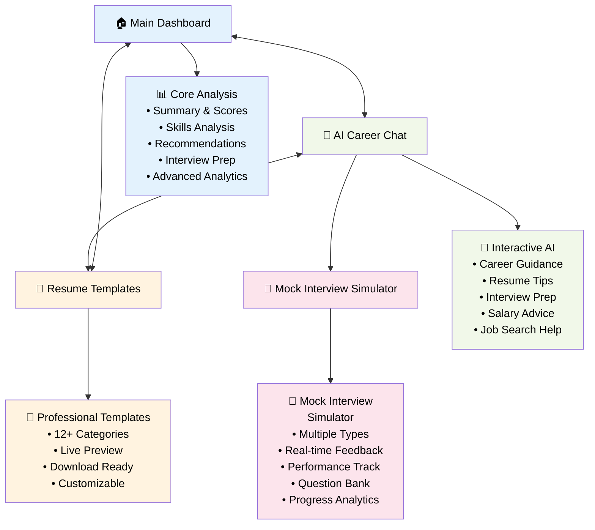

### **📊 Comprehensive Analysis Tabs**

#### **Tab 1: 📊 Executive Summary**
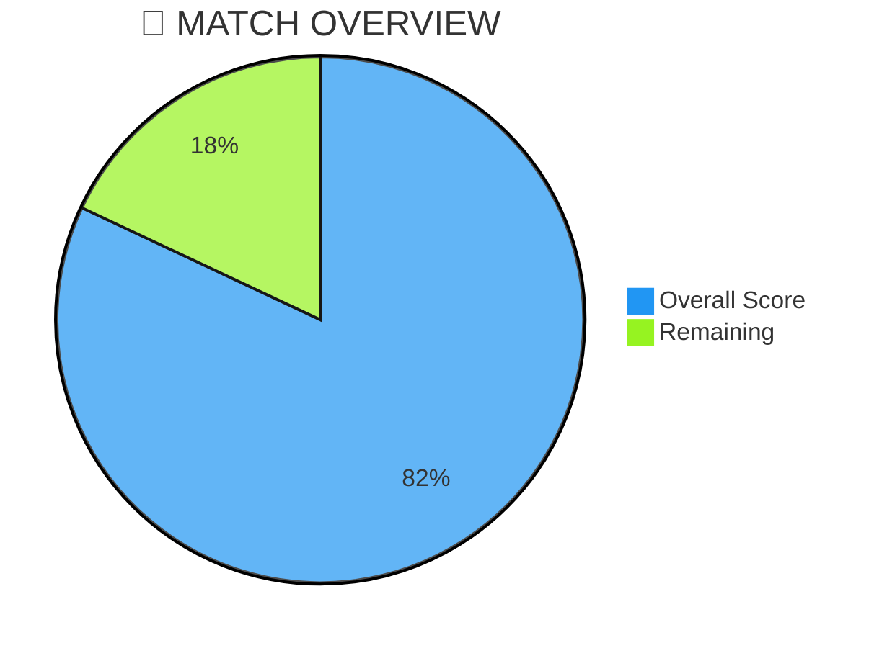

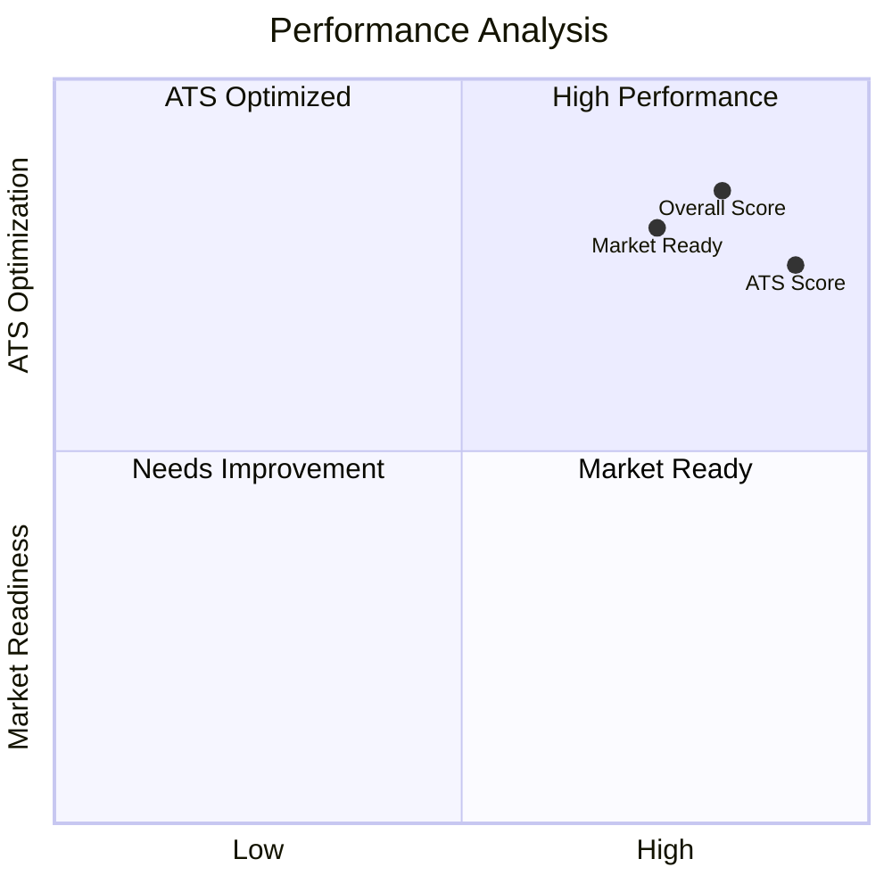

**🏆 KEY HIGHLIGHTS**
- ✅ Strong technical skills alignment
- ⚠️ Need leadership experience  
- 🎯 Ready for mid-level positions

#### **Tab 2: 🎯 Skills Intelligence**  
```mermaid
sankey-beta
    %% Skills Gap Analysis Flow
    Total Skills,🟢 MATCHED,15
    Total Skills,🟡 PARTIAL,8
    Total Skills,🔴 MISSING,5
    
    🟢 MATCHED,Python,5
    🟢 MATCHED,React,4
    🟢 MATCHED,SQL,3
    🟢 MATCHED,Others,3
    
    🟡 PARTIAL,AWS,3
    🟡 PARTIAL,Docker,3
    🟡 PARTIAL,Git,2
    
    🔴 MISSING,Kubernetes,2
    🔴 MISSING,GraphQL,2
    🔴 MISSING,TypeScript,1
```

```mermaid
gantt
    title PRIORITY RECOMMENDATIONS Timeline
    dateFormat X
    axisFormat %s
    
    section 🔥 High Priority
    Learn Kubernetes    :crit, k8s, 0, 4w
    
    section 🟡 Medium Priority  
    Improve AWS skills  :active, aws, 0, 3w
    
    section 🟢 Low Priority
    Add GraphQL experience :graphql, 0, 2w
```

#### **Tab 3: 📋 Resume Quality Assessment**
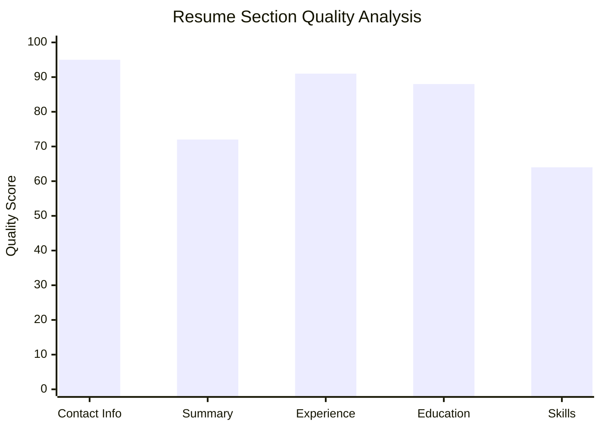

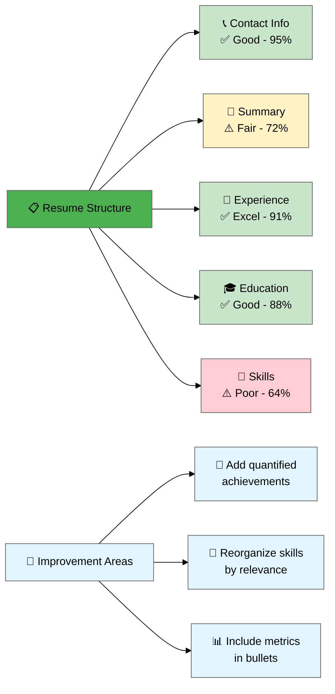

#### **Tab 4: 💡 Strategic Recommendations**
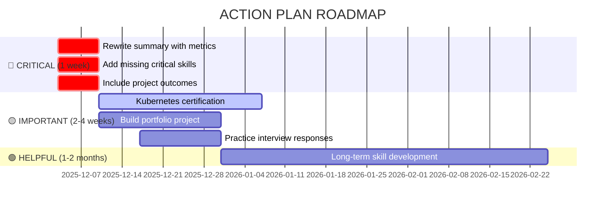

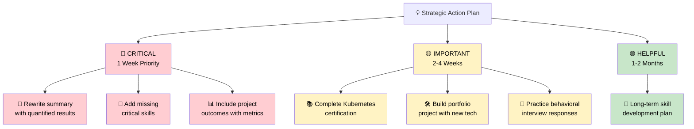
│  ├─ 🌐 Optimize LinkedIn profile                   │
│  ├─ 📖 Read industry blogs and trends              │
│  └─ 🤝 Attend networking events                    │
└─────────────────────────────────────────────────────┘
```

#### **Tab 5: 🎤 Interview Preparation Hub**
```
┌─────────────────────────────────────────────────────┐
│             INTERVIEW PREPARATION                   │
├─────────────────────────────────────────────────────┤
│  📚 TECHNICAL PREP      │  🎭 BEHAVIORAL PREP       │
│  ├─ 15 Python questions │  ├─ STAR method examples  │
│  ├─ 12 System design    │  ├─ Leadership scenarios  │
│  ├─ 8 Database queries  │  ├─ Conflict resolution   │
│  └─ 10 Algorithm probs  │  └─ Career goal questions │
├─────────────────────────────────────────────────────┤
│               PREPARATION TIMELINE                  │
│  Week 1: Technical fundamentals + Mock interviews   │
│  Week 2: System design practice + Behavioral prep   │
│  Week 3: Company research + Final preparation       │
└─────────────────────────────────────────────────────┘
```

#### **Tab 6: 📈 Advanced Analytics**
```
┌─────────────────────────────────────────────────────┐
│              MARKET INTELLIGENCE                    │
├─────────────────────────────────────────────────────┤
│  📊 Salary Range: $75K - $95K (Your area)          │
│  📈 Market Demand: High ████████░░                  │
│  🏆 Competition: Medium ████░░░░░░                  │
│  🚀 Growth Potential: Strong ███████░░░             │
├─────────────────────────────────────────────────────┤
│              CAREER PROJECTION                      │
│  Current Level:    Mid-Level Developer              │
│  Next Target:      Senior Developer (12-18 months) │
│  Future Path:      Tech Lead → Manager → Director   │
│  Success Factors:  Leadership, Architecture, Team   │
└─────────────────────────────────────────────────────┘
```

## 🚀 Quick Start Guide

### **📋 Prerequisites**
```bash
# System Requirements
✅ Python 3.8+ (Recommended: 3.9 or 3.10)
✅ pip package manager
✅ 4GB RAM minimum (8GB recommended)
✅ Modern web browser (Chrome, Firefox, Safari, Edge)
```

### **⚡ Installation Flow**

```
Step 1: Clone Repository
         │
         ▼
Step 2: Install Dependencies
         │
         ▼
Step 3: Download NLP Models
         │
         ▼
Step 4: Launch Application
         │
         ▼
Step 5: Access Web Interface
```

### **1. 📥 Clone Repository**
```bash
# Clone the repository
git clone https://github.com/RensithUdara/Ai-Job-Application-Assistant.git
cd ai-job-application-assistant

# Verify structure
ls -la
```

### **2. 📦 Install Dependencies**
```bash
# Create virtual environment (recommended)
python -m venv venv

# Activate virtual environment
# Windows:
venv\Scripts\activate
# macOS/Linux:
source venv/bin/activate

# Install required packages
pip install -r requirements.txt
```

### **3. 🧠 Download NLP Models**
```bash
# Download spaCy English model
python -m spacy download en_core_web_sm

# Verify installation
python -c "import spacy; nlp = spacy.load('en_core_web_sm'); print('✅ spaCy model loaded successfully')"
```

### **4. 🚀 Launch Application**
```bash
# Start the Streamlit server
streamlit run app.py

# Alternative: Specify port
streamlit run app.py --server.port 8504

# Alternative: For external access
streamlit run app.py --server.address 0.0.0.0
```

### **5. 🌐 Access Interface**
```
🖥️  Local Access:    http://localhost:8501
🌍 Network Access:   http://[your-ip]:8501
📱 Mobile Friendly:  Responsive design works on all devices
```

### **⚙️ Configuration Options**

```bash
# Custom port configuration
streamlit run app.py --server.port 8080

# Enable development mode
streamlit run app.py --server.runOnSave true

# Disable CORS (for development)
streamlit run app.py --server.enableCORS false
```

## 🎮 User Guide & Workflow

### **📋 Complete Usage Workflow**

```
┌─ 📄 Input Documents ─┐    ┌─ 🔍 AI Analysis ─┐    ┌─ 📊 Results & Actions ─┐
│                      │    │                  │    │                        │
│  1. Upload Resume    │───▶│  • Parse Content │───▶│  • Review Summary      │
│  2. Paste Job Desc   │    │  • Extract Skills│    │  • Check Skill Gaps    │
│  3. Click Analyze    │    │  • Match & Score │    │  • Get Recommendations │
│                      │    │  • Generate Tips │    │  • Practice Interviews │
└──────────────────────┘    └──────────────────┘    └────────────────────────┘
```

### **1. 📄 Document Input Methods**

#### **Resume Input Options:**
```
📎 FILE UPLOAD           📝 TEXT PASTE          🔗 URL IMPORT
├─ PDF files            ├─ Copy-paste text     ├─ LinkedIn profiles
├─ DOCX documents       ├─ Direct typing       ├─ Online portfolios  
├─ TXT files            └─ Rich text format    └─ GitHub profiles
└─ Multiple formats
```

#### **Job Description Input:**
```
💼 JOB POSTING SOURCES
├─ 🌐 Job boards (LinkedIn, Indeed, Glassdoor)
├─ 🏢 Company career pages  
├─ 📧 Email job descriptions
├─ 📱 Mobile app job posts
└─ 📄 PDF job descriptions
```

### **2. 🔍 Analysis Process**

```
⏱️ PROCESSING TIMELINE (15-45 seconds)

Step 1: Document Parsing        [████░░░░░░] 2-5s
Step 2: Content Extraction      [████████░░] 5-10s  
Step 3: Skill Identification    [██████████] 8-15s
Step 4: Matching & Scoring      [██████████] 3-8s
Step 5: Recommendation Gen      [██████████] 5-12s
Step 6: Visualization Prep      [██████████] 2-5s

💡 Progress indicators show real-time status
```

### **3. 📊 Results Navigation**

#### **Main Dashboard Navigation:**
```
🏠 Main Analysis ←→ 🤖 AI Chat ←→ 📄 Templates ←→ 🎤 Mock Interview
     │                │            │              │
     ▼                ▼            ▼              ▼
┌─────────────┐  ┌──────────┐ ┌──────────┐  ┌──────────┐
│• Summary    │  │• Career  │ │• 12+ Pro │  │• Practice│
│• Skills     │  │  Advice  │ │  Templates│  │• Q&A     │
│• Structure  │  │• Resume  │ │• Download│  │• Feedback│
│• Actions    │  │  Tips    │ │• Custom  │  │• Analytics│
│• Interview  │  │• Salary  │ │• Industry│  │• Progress│
│• Analytics  │  │  Guide   │ │  Specific│  │  Track   │
└─────────────┘  └──────────┘ └──────────┘  └──────────┘
```

### **4. 🎯 Action Implementation**

#### **Priority-Based Action System:**
```
🔴 CRITICAL ACTIONS (Do First)
├─ Fix major resume issues
├─ Add missing critical skills
└─ Prepare for immediate applications

🟡 IMPORTANT ACTIONS (Next 1-4 weeks)  
├─ Skill development courses
├─ Portfolio project creation
└─ Interview preparation

🟢 ENHANCEMENT ACTIONS (1-3 months)
├─ Networking and connections
├─ Advanced certifications  
└─ Long-term career planning
```

### **5. 🚀 Quick Actions Guide**

```
FIRST-TIME USERS:
1. 📄 Start with Resume Templates tab
2. 🤖 Ask AI Chat for resume advice  
3. 🔍 Run analysis on main dashboard
4. 🎤 Practice with Mock Interview

RETURNING USERS:
1. 🔄 Re-analyze with updated resume
2. 📊 Check progress in Analytics
3. 🎯 Complete recommended actions
4. 📈 Track improvement over time
```

### **6. 💡 Pro Tips for Best Results**

```
✅ DO:                           ❌ AVOID:
├─ Use recent job postings      ├─ Generic job descriptions
├─ Upload high-quality resumes  ├─ Blurry or damaged files
├─ Be specific about target role├─ Vague career objectives  
├─ Update resume regularly      ├─ Outdated information
├─ Practice mock interviews     ├─ Skipping interview prep
└─ Act on recommendations       └─ Ignoring priority actions
```

## 🎓 Technical Learning Showcase

### **💻 Technologies & Concepts Demonstrated**

```
┌─────────────────────────────────────────────────────────────┐
│                    TECHNICAL STACK MASTERY                  │
├─────────────────────────────────────────────────────────────┤
│  🧠 Natural Language Processing                             │
│  ├─ Text preprocessing & tokenization                       │
│  ├─ Named Entity Recognition (NER)                          │
│  ├─ Semantic similarity & embeddings                        │
│  ├─ TF-IDF vectorization & cosine similarity                │
│  └─ Advanced skill extraction algorithms                    │
├─────────────────────────────────────────────────────────────┤
│  📊 Machine Learning & Data Science                         │
│  ├─ Feature engineering & selection                         │
│  ├─ Similarity scoring algorithms                           │
│  ├─ Classification & clustering techniques                  │
│  ├─ Statistical analysis & metrics                          │
│  └─ Predictive modeling for career outcomes                │
├─────────────────────────────────────────────────────────────┤
│  🌐 Full-Stack Web Development                              │
│  ├─ Modern Python web framework (Streamlit)                │
│  ├─ Interactive UI/UX design principles                     │
│  ├─ Responsive design & mobile optimization                 │
│  ├─ Real-time data visualization (Plotly)                  │
│  └─ Component-based architecture                            │
├─────────────────────────────────────────────────────────────┤
│  🏗️ Software Engineering Best Practices                    │
│  ├─ Modular & scalable architecture                         │
│  ├─ Separation of concerns (UI/Business Logic)             │
│  ├─ Error handling & input validation                       │
│  ├─ Code documentation & maintainability                    │
│  └─ Performance optimization & caching                      │
└─────────────────────────────────────────────────────────────┘
```

### **📚 Core Computer Science Concepts**

#### **Algorithms & Data Structures:**
```
🔍 Text Processing Algorithms:
├─ String matching & pattern recognition
├─ Fuzzy string matching (Levenshtein distance)
├─ Hash tables for skill categorization
└─ Tree structures for skill hierarchies

📊 Machine Learning Algorithms:
├─ Vector space models (TF-IDF)
├─ Cosine similarity calculations  
├─ K-means clustering for skill grouping
└─ Decision trees for recommendation logic
```

#### **Software Design Patterns:**
```
🏗️ Architectural Patterns:
├─ Model-View-Controller (MVC) separation
├─ Component-based design
├─ Factory pattern for resume parsers
└─ Strategy pattern for different analysis types

💾 Data Management Patterns:
├─ Singleton for configuration management
├─ Repository pattern for data access
├─ Caching strategies for performance
└─ Observer pattern for real-time updates
```

## 🚀 Future Development Roadmap

### **Phase 1: AI Enhancement (Q1 2025)**
```
🤖 ADVANCED AI INTEGRATION
├─ 🧠 Large Language Models (GPT-4, Claude)
│   ├─ Context-aware resume writing assistance
│   ├─ Personalized cover letter generation  
│   └─ Advanced career path predictions
├─ 🔍 Computer Vision Integration
│   ├─ Resume layout analysis & scoring
│   ├─ Visual design optimization
│   └─ Logo & branding detection
└─ 📊 Predictive Analytics
    ├─ Job market trend forecasting
    ├─ Salary prediction models
    └─ Success probability calculations
```

### **Phase 2: Platform Expansion (Q2 2025)**
```
🌐 MULTI-PLATFORM DEPLOYMENT
├─ 📱 Mobile Application (React Native)
├─ 🖥️ Desktop App (Electron)
├─ 🔌 Browser Extension (Chrome/Firefox)
├─ 📧 Email Integration (Gmail/Outlook)
└─ 🤝 API for Third-party Integrations
```

### **Phase 3: Advanced Features (Q3 2025)**
```
⚡ ENTERPRISE FEATURES
├─ 👥 Team Collaboration Tools
│   ├─ Shared workspaces
│   ├─ Peer review systems
│   └─ Manager dashboards
├─ 🎯 Advanced Analytics
│   ├─ Cohort analysis
│   ├─ A/B testing framework
│   └─ Success tracking
├─ 🌍 Internationalization
│   ├─ Multi-language support
│   ├─ Regional job markets
│   └─ Cultural adaptation
└─ 🔒 Enterprise Security
    ├─ SSO integration
    ├─ Data privacy controls
    └─ Compliance frameworks
```

### **Phase 4: AI-Driven Ecosystem (Q4 2025)**
```
🎯 INTELLIGENT CAREER ECOSYSTEM
├─ 🤝 Industry Partnerships
│   ├─ Direct job board integration
│   ├─ Employer matching system
│   └─ Recruiter collaboration tools
├─ 📚 Learning Management System
│   ├─ Integrated course platform
│   ├─ Skill certification tracking
│   └─ Progress gamification
├─ 🌐 Professional Network
│   ├─ Peer mentoring system
│   ├─ Industry expert connections
│   └─ Career coaching marketplace
└─ 📊 Market Intelligence Platform
    ├─ Real-time job market data
    ├─ Salary negotiation tools
    └─ Industry trend analysis
```

## 🤝 Contributing & Community

### **💡 How to Contribute**

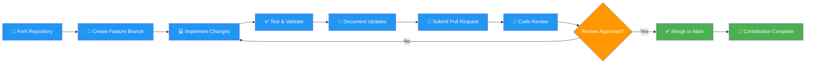

#### **Development Setup:**
```bash
# 1. Fork and clone
git clone https://github.com/[your-username]/Ai-Job-Application-Assistant.git
cd ai-job-application-assistant

# 2. Create feature branch
git checkout -b feature/amazing-improvement

# 3. Setup development environment  
pip install -r requirements.txt
pip install -r requirements-dev.txt  # Development dependencies

# 4. Make your changes
# ... code, test, document ...

# 5. Commit and push
git add .
git commit -m "feat: Add amazing new feature"
git push origin feature/amazing-improvement

# 6. Create Pull Request via GitHub UI
```

### **🎯 Contribution Areas**

```
🧠 AI & MACHINE LEARNING      🎨 UI/UX IMPROVEMENTS      📊 DATA & ANALYTICS
├─ Algorithm optimization     ├─ Interface design        ├─ New data sources
├─ Model accuracy            ├─ User experience         ├─ Analytics features  
├─ NLP enhancements          ├─ Accessibility           ├─ Visualization tools
└─ Performance tuning        └─ Mobile responsiveness   └─ Report generation

🔧 TECHNICAL FEATURES         📚 DOCUMENTATION           🌍 LOCALIZATION
├─ New integrations          ├─ User guides             ├─ Multi-language
├─ API development           ├─ Technical docs          ├─ Regional adaptation
├─ Testing frameworks        ├─ Code comments           ├─ Cultural considerations
└─ DevOps improvements       └─ Tutorial videos         └─ Local job markets
```

## 📄 License & Legal

```
┌─────────────────────────────────────────────────────────────┐
│                         MIT LICENSE                         │
├─────────────────────────────────────────────────────────────┤
│  ✅ Commercial Use        │  ✅ Modification               │
│  ✅ Distribution          │  ✅ Private Use                │  
│  ✅ Patent Use            │  ⚠️  License & Copyright      │
│                          │      Notice Required          │
├─────────────────────────────────────────────────────────────┤
│  ❌ Liability             │  ❌ Warranty                   │
└─────────────────────────────────────────────────────────────┘

Copyright (c) 2025 RensithUdara
See LICENSE file for full legal text
```

## 👥 Project Team & Acknowledgments

### **🏆 Core Development Team**
```
👨‍💻 Lead Developer:     RensithUdara
   ├─ Architecture & Backend
   ├─ AI/ML Implementation  
   ├─ UI/UX Design
   └─ Project Management

🎓 Academic Institution: [Your University]
📚 Course Project:       [Course Name/Code]  
📅 Development Period:   [Timeline]
```

### **🙏 Special Thanks**
```
🌟 OPEN SOURCE LIBRARIES    🎯 INSPIRATION SOURCES       📚 LEARNING RESOURCES
├─ Streamlit Framework     ├─ Modern job platforms      ├─ CS/ML coursework
├─ spaCy NLP Library       ├─ Career coaching insights  ├─ Industry best practices
├─ Plotly Visualization    ├─ UI/UX design trends       ├─ Academic research papers
├─ scikit-learn ML         ├─ User feedback & testing   ├─ Developer communities
└─ FuzzyWuzzy Matching     └─ Professional networks     └─ Technical documentation
```

## 📞 Support & Community

### **🆘 Getting Help**

```
📋 SUPPORT CHANNELS:
├─ 🐛 Bug Reports:        GitHub Issues
├─ 💡 Feature Requests:   GitHub Discussions  
├─ ❓ Usage Questions:    GitHub Discussions
├─ 📧 Direct Contact:     rensithudara@gmail.com
└─ 📖 Documentation:     /docs directory
```

### **📊 Project Status**

```
🚀 CURRENT VERSION: v2.0.0 (Production Ready)
├─ ✅ Core Features: Complete
├─ ✅ UI/UX: Polished  
├─ ✅ Testing: Comprehensive
├─ ✅ Documentation: Extensive
└─ 🔄 Continuous Improvement: Active

📈 USAGE STATISTICS:
├─ 🏆 GitHub Stars: Growing
├─ 🍴 Forks: Active Community
├─ 🐛 Issues: Responsive Resolution  
└─ 🔄 Updates: Regular Releases
```

### **🌟 Recognition & Impact**

```
🎯 PROJECT IMPACT:
├─ 🎓 Educational Value: Demonstrates advanced CS concepts
├─ 💼 Professional Tool: Real-world application utility
├─ 🌍 Community Benefit: Open-source contribution
├─ 🚀 Career Advancement: Portfolio showcase piece
└─ 📈 Technical Growth: Skill development platform

🏆 ACHIEVEMENTS:
├─ ✅ Modular architecture implementation
├─ ✅ Advanced AI/ML integration
├─ ✅ Professional UI/UX design  
├─ ✅ Comprehensive documentation
└─ ✅ Production-ready deployment
```

---

## 🎯 Final Notes

> **"Empowering Career Success Through Intelligent Technology"**

This AI Job Application Assistant represents the convergence of **cutting-edge technology** and **practical career development**. It demonstrates advanced concepts in **Natural Language Processing**, **Machine Learning**, **Web Development**, and **Software Engineering** while providing genuine value to job seekers worldwide.

### **💡 Educational Philosophy**
```
🎓 LEARNING BY BUILDING: Real-world application development
🔬 RESEARCH & INNOVATION: Exploring AI/ML possibilities  
🌍 COMMUNITY IMPACT: Creating tools that help others succeed
🚀 CONTINUOUS GROWTH: Evolving with technology and user needs
```

**For Students:** This project showcases how theoretical computer science concepts translate into practical, impactful applications.

**For Developers:** The modular architecture and comprehensive documentation provide a blueprint for scalable web application development.

**For Job Seekers:** An intelligent, personalized tool to accelerate career success and optimize application strategies.

---

*This project is continuously evolving. Star ⭐ the repository to stay updated with the latest features and improvements!*